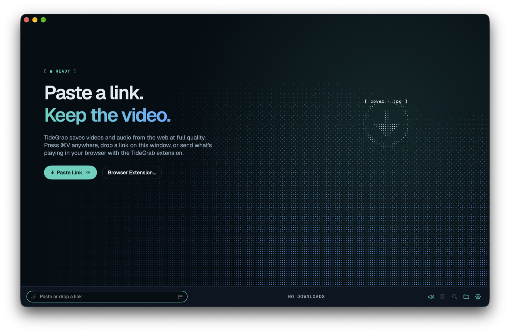
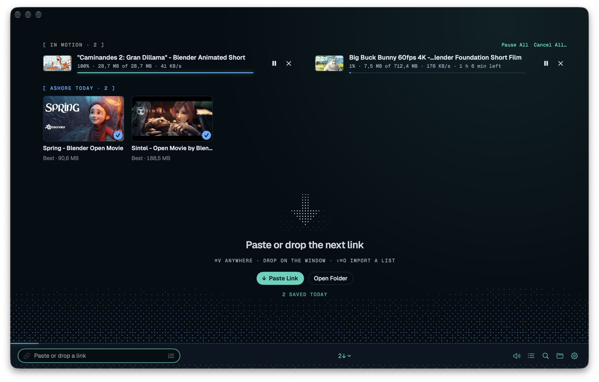

# TideGrab

TideGrab is a macOS app for saving video and audio from the web. Paste a link, pick a quality, and
TideGrab downloads it into a resumable queue. For pages it can't read directly, it opens the page in
its own window and catches the media you play.

This repository hosts TideGrab's releases and its update feed.

## Download

**[Download the latest TideGrab](https://github.com/h3x4d3x4/TideGrab-Releases/releases/latest/download/TideGrab.dmg)**
(macOS 15 or later, Apple silicon). All versions are on the [Releases](https://github.com/h3x4d3x4/TideGrab-Releases/releases) page.

Every DMG is signed with a Developer ID and notarized by Apple. Open it and drag TideGrab to Applications.

## Updates

TideGrab checks for updates once a day (Settings › Updates) and installs them when you quit.
The feed is [`appcast.xml`](appcast.xml) in this repository. Every update is signed, and TideGrab
refuses an update whose signature doesn't match.

## Source for open-source components

Each release includes `TideGrab-<version>-sources.tar.gz` with the source of the open-source helpers
in that version (yt-dlp, and the LGPL build of FFmpeg with LAME, mpg123 and Opus), as their licences
require. The licences themselves are in the app under Help › Acknowledgements.

## Support

- Website: [tidegrab.hexadexa.io](https://tidegrab.hexadexa.io)
- Privacy: [tidegrab.hexadexa.io/privacy](https://tidegrab.hexadexa.io/privacy)
- Email: [support@hexadexa.dev](mailto:support@hexadexa.dev)

## Screenshots

Screenshots show Blender Foundation open movies, CC BY ([blender.org](https://www.blender.org/about/projects/)).

TideGrab is made by Hexadexa. © 2026 Hexadexa. All rights reserved.
